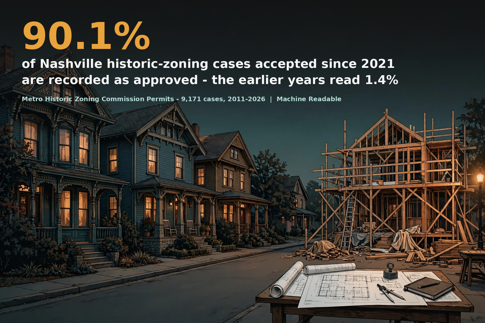

# Nashville Historic Zoning Commission Permits - a Machine Readable data brief



Of **9,171 historic-zoning permit cases** accepted from December 7, 2011 to November 6, 2026, **8,337 (90.9 percent) carry an issued date** and 59.8 percent of those issued the same day; among cases accepted since 2021, **90.1 percent are recorded as approved**, against 1.4 percent for 2011-2020 - a break inside the register's own Decision field, documented in the brief.

Full brief: [brief-draft.md](brief-draft.md) | Sources: [sources.md](sources.md) | Verification: [verification.md](verification.md)

## Contents

- `brief-draft.md` - the brief
- `hero.png` - headline graphic (generated illustration, brand palette, headline composited on top)
- `charts/` - cases by subtype, median days by subtype, Decision counter as recorded, cases by ZIP
- `stats.json` - every headline figure with its population printed
- `data/` - panels, the pre-flight audit output, the pull log, the source layer metadata, and the independent verifier output. The raw snapshot CSV is not carried in this repository (it includes applicant contact fields as served); it is retained as a parquet in the project warehouse stack (stack/nashville/snapshots/2026-11-09/nashville_historic_zoning_raw.parquet) and is reproducible any time with `code/pull_data.py`
- `code/` - `pull_data.py`, `audit_section10.py`, `build_stats.py`, `verify_independent.py`, `charts.py`, `hero_composite.py`
- `verification.md` - pre-flight audit, methods checklist, sync gate, story gate

## Reproduce

```
python3 code/pull_data.py          # full-layer pull from the live service (snapshot will drift from the archived one)
python3 code/audit_section10.py    # writes data/audit_output.txt
python3 code/build_stats.py        # writes stats.json and data/*_panel.csv
python3 code/verify_independent.py # second implementation (pandas) + live server count
python3 code/charts.py
python3 code/hero_composite.py     # needs generated art in hero_source/
```

Dependencies (matching the code's actual imports): Python 3 standard library plus pandas (verifier only) and matplotlib + Pillow (charts and hero only). The pull, audit, and build scripts use only the standard library.

## Source

Metropolitan Historic Zoning Commission Permits, Metropolitan Government of Nashville and Davidson County via the Nashville Open Data Portal, ArcGIS FeatureServer layer 0 (services2.arcgis.com/HdTo6HJqh92wn4D8). Snapshot November 9, 2026; population accepted December 7, 2011 to November 6, 2026.

## License

Brief text and derived data products: CC BY 4.0 (see LICENSE). Underlying records are Metro Nashville government open data.

*Machine Readable is a public-good civic data project by Alex Dowlen.*
